# TaskFlow client

Angular 21 client for a Trello-like project board. Boards contain four task columns (To Do, In Progress, In Review, Done), milestones, comments, progress bars, and an ordered activity history. Desktop users can drag cards between columns. Opening a card also lets users change its status, including on touch devices.

## Start locally (PowerShell)

Keep the [client](https://github.com/HussainALAradi5/task-flow-proto-client-side), [server](https://github.com/HussainALAradi5/task-flow-proto-server-side), and [documentation](https://github.com/HussainALAradi5/task-flow-proto-documenation) repositories side by side. Use Node.js 24 LTS and a reachable MongoDB database.

```powershell
# Terminal 1, from the server repository
npm ci
Copy-Item .env.example .env
# Edit .env: MONGO_URI and JWT_SECRET are required.
npm run dev

# Terminal 2, from the client repository
npm ci
npm start
```

Open <http://localhost:4200>. The development client uses `http://localhost:5000/api` in `src/environments/environment.ts`; keep the server at port 5000 or change that URL. See the [server README](https://github.com/HussainALAradi5/task-flow-proto-server-side#start-locally-powershell) for database setup and the demo seed. For a production build, configure the deployed API URL in `src/environments/environment.prod.ts` before building.

## Demo users

Run `npm run seed:demo` in the server repository as described in its README. The script requires `DEMO_SEED=1` and a password of at least 12 characters supplied with `DEMO_SEED_PASSWORD`. All accounts use that chosen password.

| Login email | Role | Group and access |
| --- | --- | --- |
| `demo-admin@taskflow.local` | Admin | Can see all teams and boards; owns Operations Group |
| `demo@taskflow.local` | Leader | Owns Product Studio and its three sample boards |
| `demo-member@taskflow.local` | Member | Member of Operations Group and its Operations Board; cannot see Product Studio boards |

The login form also accepts `demo_admin`, `demo_leader`, or `demo_member` as the identifier. The Operations Board has a card created by the Admin so you can verify that a Member can move and comment on another user's card.

## Board behavior and access

Project boards and team lists are scoped to ownership or explicit membership. Members can read their board's milestones and activity, and create, move, edit, and comment on cards there. Leaders or Admins manage milestones; board and team edits require the owner or Admin. The server enforces these rules. Each board shows recent activity in reverse time order and can load older events. Actions write history on the server; clients cannot create audit events directly.

The progress bar shared component displays board and milestone completion. The shared UI library also includes button, card, dialog, loading, search, select, badge select, badge, switch, pagination, input, password input, alert, toast, table, file upload, drag drop, and access control components. `generic-progress-bar` accepts `label`, a 0–100 `value`, `size`, and `tone`:

```html
<app-generic-progress-bar label="Board completion" [value]="progressPercent()" size="sm" tone="mixed" />
```

## Screenshots

The first gallery uses mocked API responses representing the demo seed to show the main screens at desktop and mobile widths. The final three images come from a real client and API running against an isolated temporary MongoDB instance. That live run seeded twice, logged in as all three roles, moved and commented on an Admin-created card as the Member, and loaded board activity. The configured deployment database was not used.


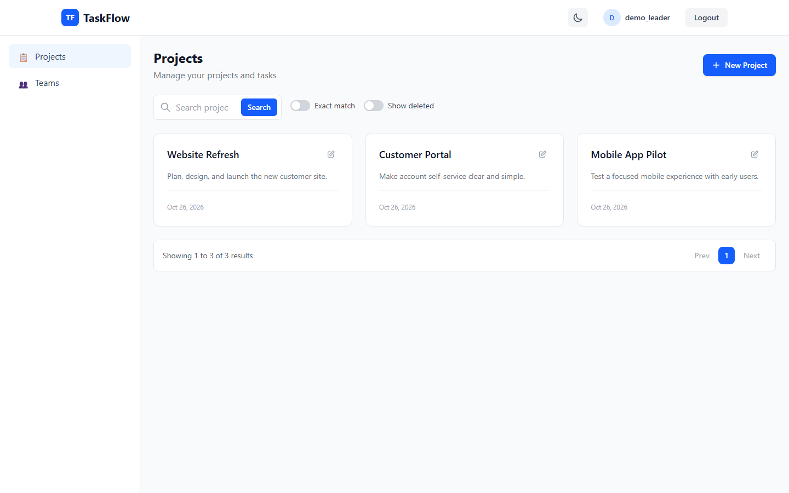
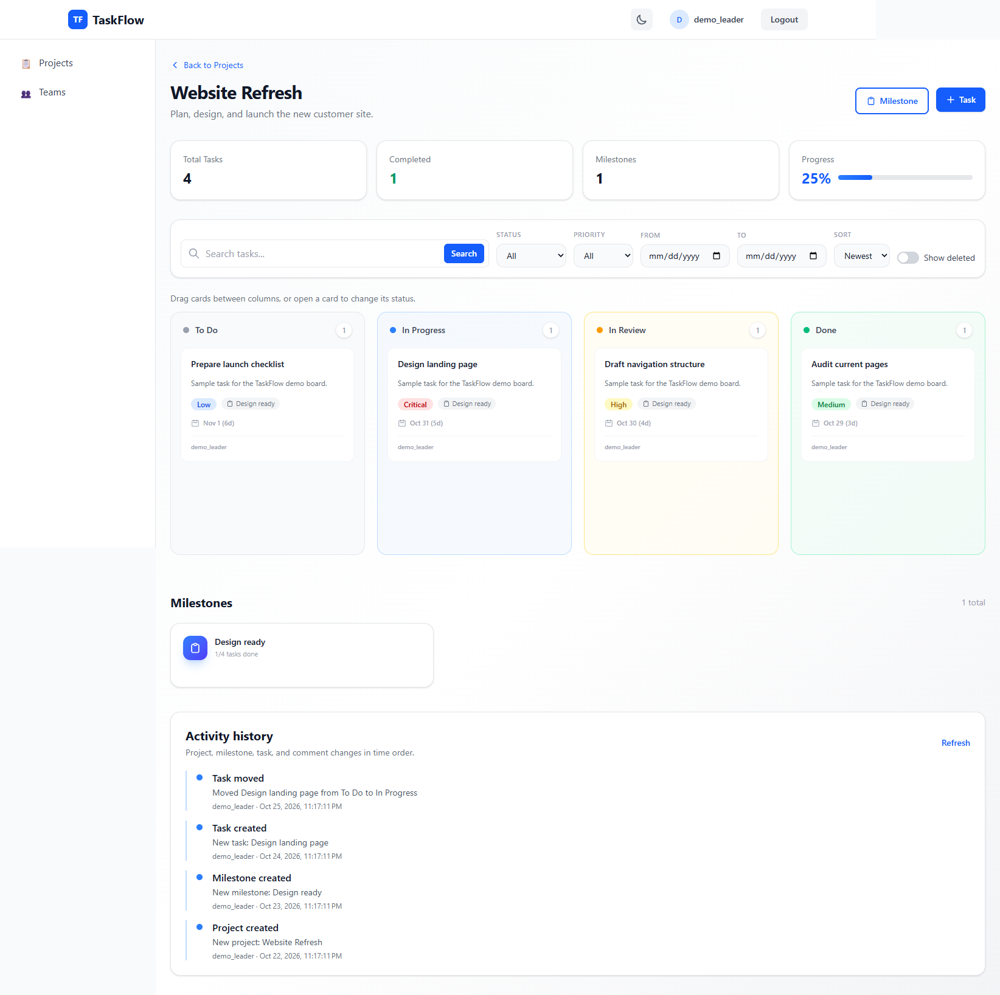
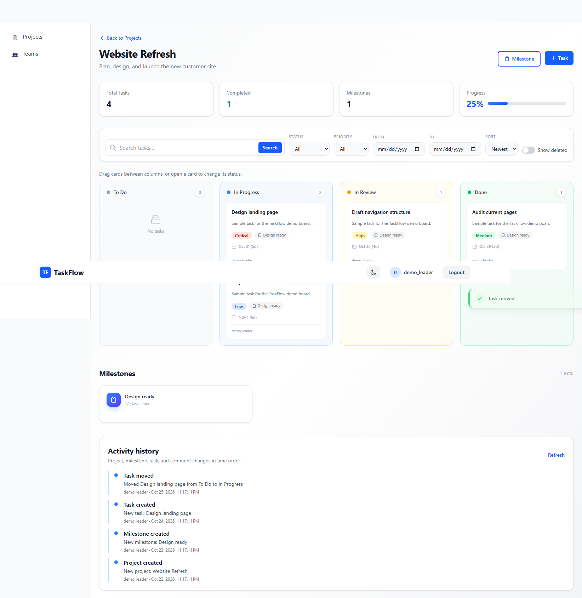
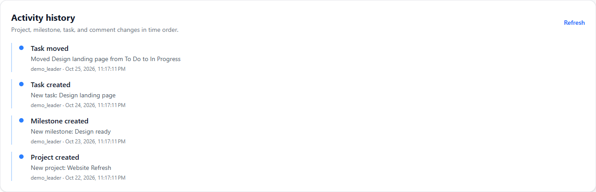
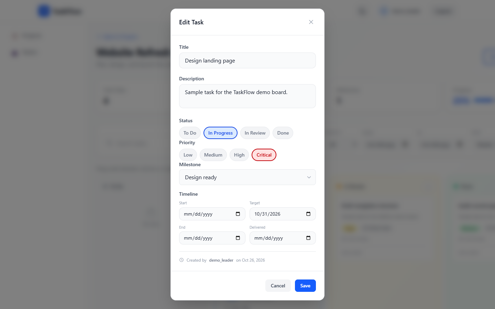
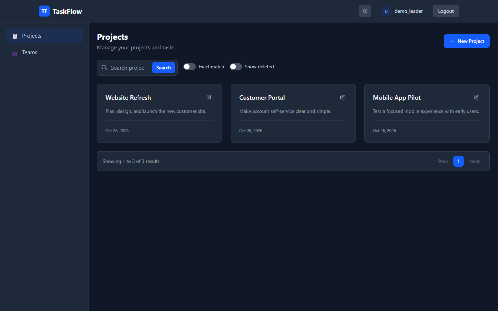
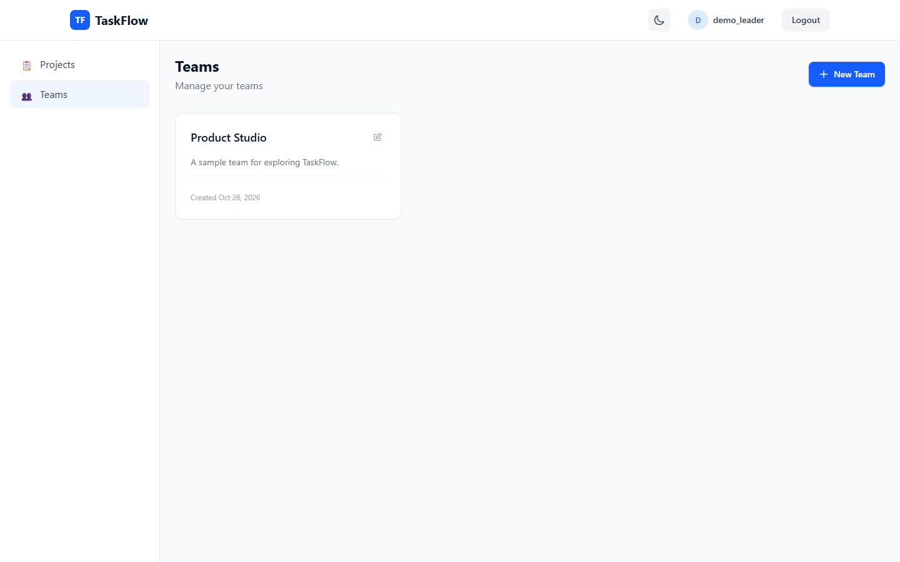
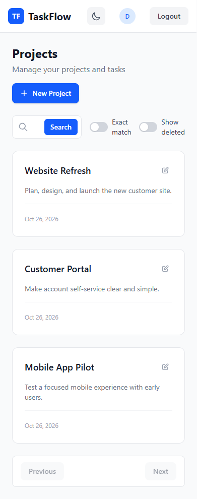


### Live demo flow

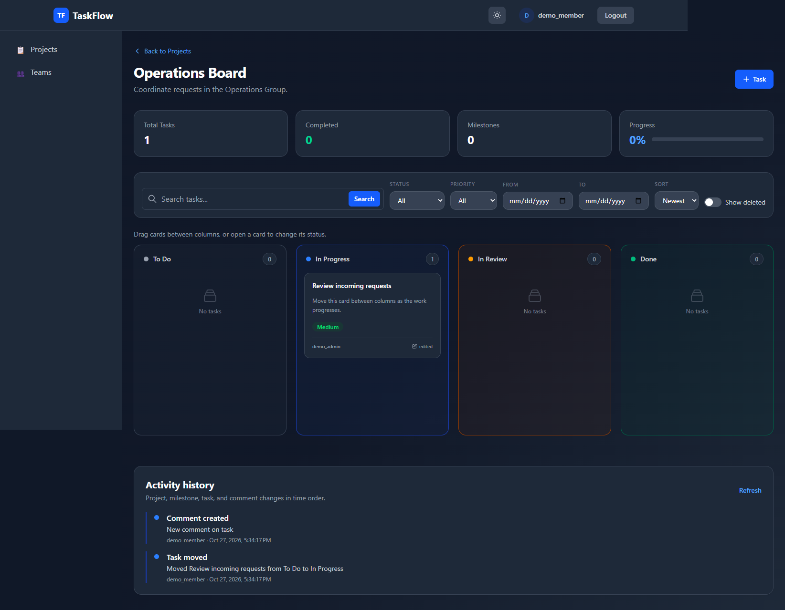
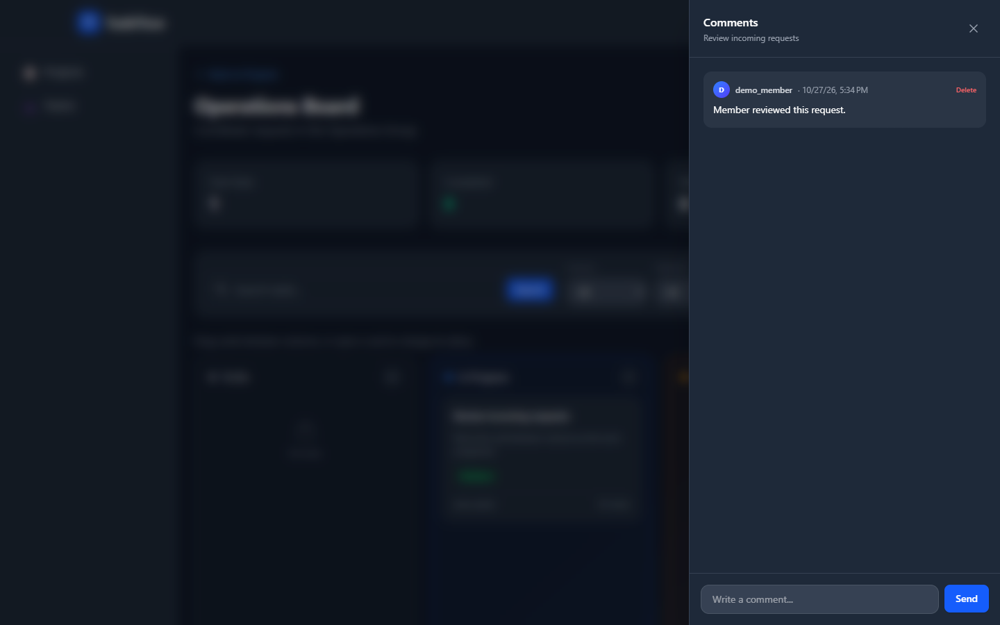
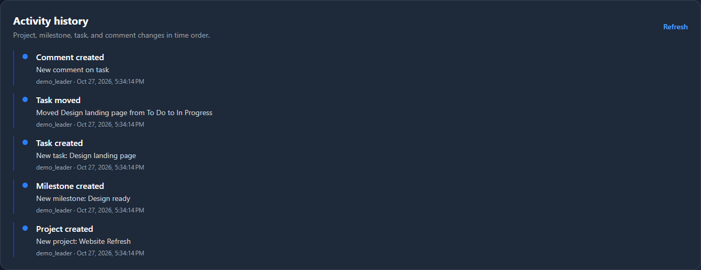

## Checks

```powershell
npm run build
npm test
```

See the [contract verification](https://github.com/HussainALAradi5/task-flow-proto-documenation/blob/main/contract-verification.md) for API route and role details.
