# TaskFlow client

Angular 21 client for a Trello-inspired project board. Boards contain four task columns (To Do, In Progress, In Review, Done), milestones, card discussions with small images/GIFs, progress bars, and an ordered activity history. Desktop users can drag cards between columns. Opening a card also lets users change its status, including on touch devices. Teams have linked boards and a private chat, and the header bell opens a read/unread notification inbox.

## Live demo

Open the [TaskFlow client](https://taskflow-proto-client.onrender.com) to try the app. Its [API](https://taskflow-proto-api.onrender.com/) runs on a free Render web service, so the first request after inactivity may take about a minute. Sign in with one of the [demo users](#demo-users) and the demo password provided privately by the project owner. Do not publish the Admin password in this repository. The live demo uses a dedicated free MongoDB Atlas cluster.

## Start locally (PowerShell)

Keep the [client](https://github.com/HussainALAradi5/task-flow-proto-client-side), [server](https://github.com/HussainALAradi5/task-flow-proto-server-side), and [documentation](https://github.com/HussainALAradi5/task-flow-proto-documenation) repositories side by side. Use Node.js 24 LTS and a reachable MongoDB database.

```powershell
# Terminal 1, from the server repository
npm ci
Copy-Item .env.example .env
# Edit .env: MONGO_URI and JWT_SECRET are required.
npm run dev

# Terminal 2, from the client repository
npm ci
npm start
```

Open <http://localhost:4200>. The development client uses `http://localhost:5000/api` in `src/environments/environment.ts`; keep the server at port 5000 or change that URL. See the [server README](https://github.com/HussainALAradi5/task-flow-proto-server-side#start-locally-powershell) for database setup and the demo seed. For a production build, configure the deployed API URL in `src/environments/environment.prod.ts` before building.

## Demo users

Run `npm run seed:demo` in the server repository as described in its README. The script requires `DEMO_SEED=1` and a password of at least 12 characters supplied with `DEMO_SEED_PASSWORD`. All accounts use that chosen password.

| Login email | Role | Group and access |
| --- | --- | --- |
| `demo-admin@taskflow.local` | Admin | Can see all teams and boards; owns Operations Group |
| `demo@taskflow.local` | Leader | Owns Product Studio and its three sample boards |
| `demo-member@taskflow.local` | Member | Member of Operations Group and its Operations Board; cannot see Product Studio boards |

The login form also accepts `demo_admin`, `demo_leader`, or `demo_member` as the identifier. The Operations Board has a card created by the Admin so you can verify that a Member can move and comment on another user's card.

## Board behavior and access

Project boards and team lists are scoped to ownership or explicit membership. Members can read their board's milestones and activity, and create, move, edit, and comment on cards there. Leaders or Admins manage milestones; only the team creator can edit its details and membership. The server enforces these rules. Each board shows recent activity in reverse time order and can load older events. Actions write history on the server; clients cannot create audit events directly.

Team owners can invite a registered user by email from **Teams → Manage**. The recipient sees an invitation count in the header and accepts or declines in Teams. Acceptance grants access to the team and its active boards. Each team lists its **Team leader** and **Team members** with badges; the profile shows the account role separately, so a person can lead one team and be a member of another. Accepted members can open **Team chat** for text and one small image or GIF per message. The Teams page lists linked boards. Projects can be filtered to All, My projects, or Team projects; team and project collections offer grid/list views. The header bell opens **Notifications**, where each user can filter unread items, open their destination, or mark one or all as read. Task start, target, end, and delivery dates must be chronological and cannot precede card creation. Card discussion supports text and one PNG, JPEG, GIF, or WebP image up to 500 KB per comment. See the [workflow review](https://github.com/HussainALAradi5/task-flow-proto-documenation/blob/main/trello-workflow-review.md) for feature scope and limits.

Sign in with the account email shown above. Username or mobile number remains supported. Email entry ignores letter case and extra surrounding spaces.

The progress bar shared component displays board and milestone completion. The shared UI library also includes button, card, dialog, loading, search, select, badge select, badge, switch, pagination, input, password input, alert, toast, table, file upload, and drag drop components. An unused access control component with fake user suggestions was removed; real team invitations use account email lookup. `generic-progress-bar` accepts `label`, a 0–100 `value`, `size`, and `tone`:

```html
<app-generic-progress-bar label="Board completion" [value]="progressPercent()" size="sm" tone="mixed" />
```

## Screenshots

The role gallery below comes from the real client and API. The original board and card flows used an isolated temporary MongoDB database with the demo seed; the latest project, team, chat, and notification views were captured from the deployed free demo. The Member moved and commented on an Admin-created card; the board's ordered history recorded both actions.

### Sign in and Admin

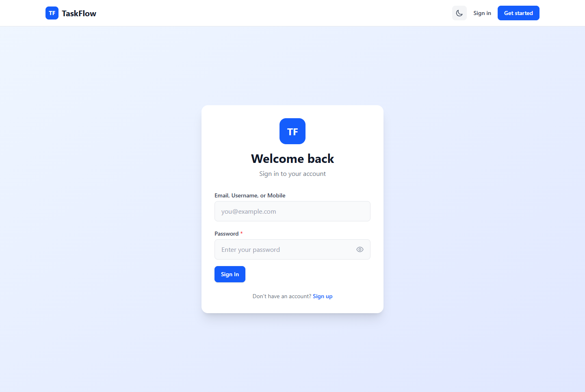
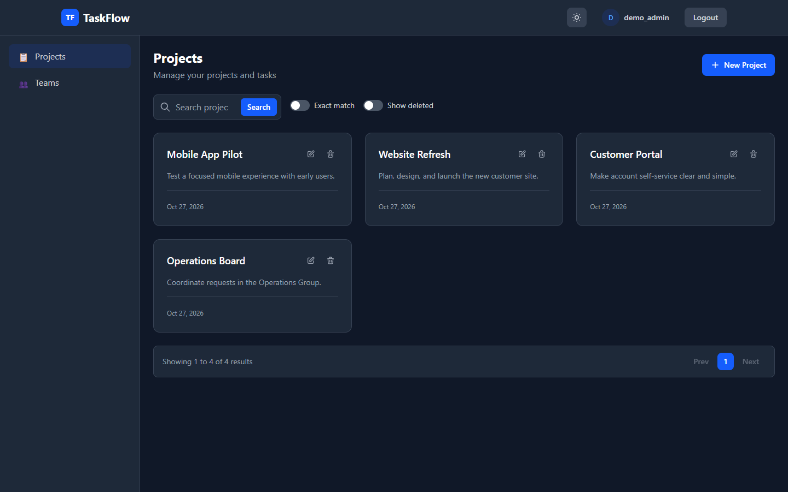
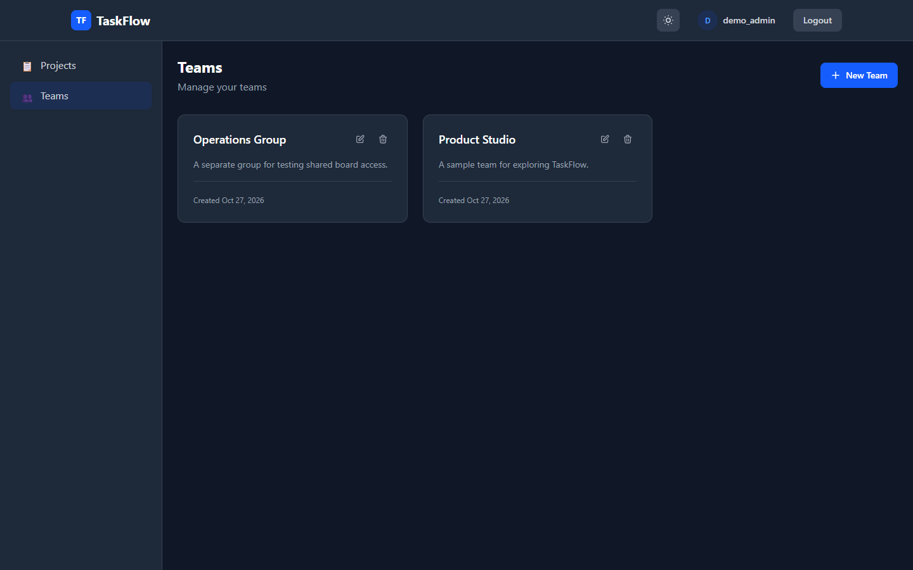

### Leader

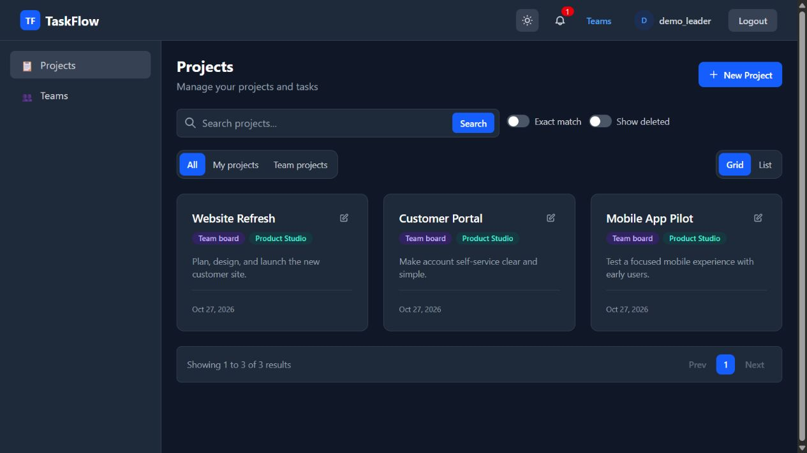
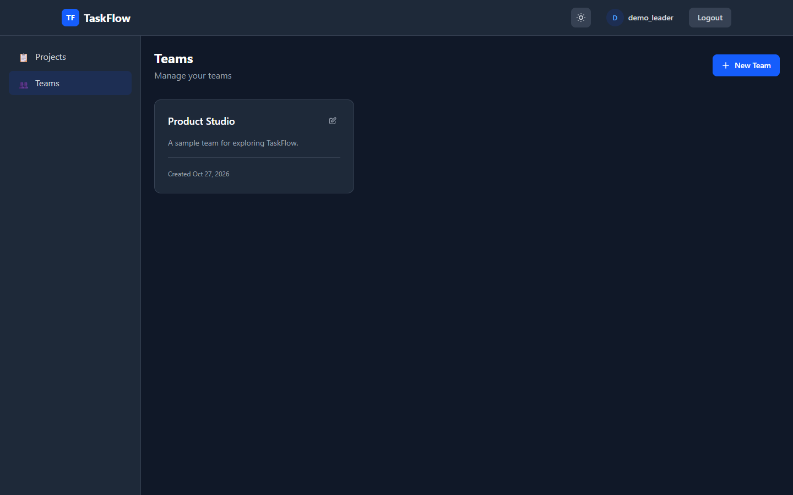
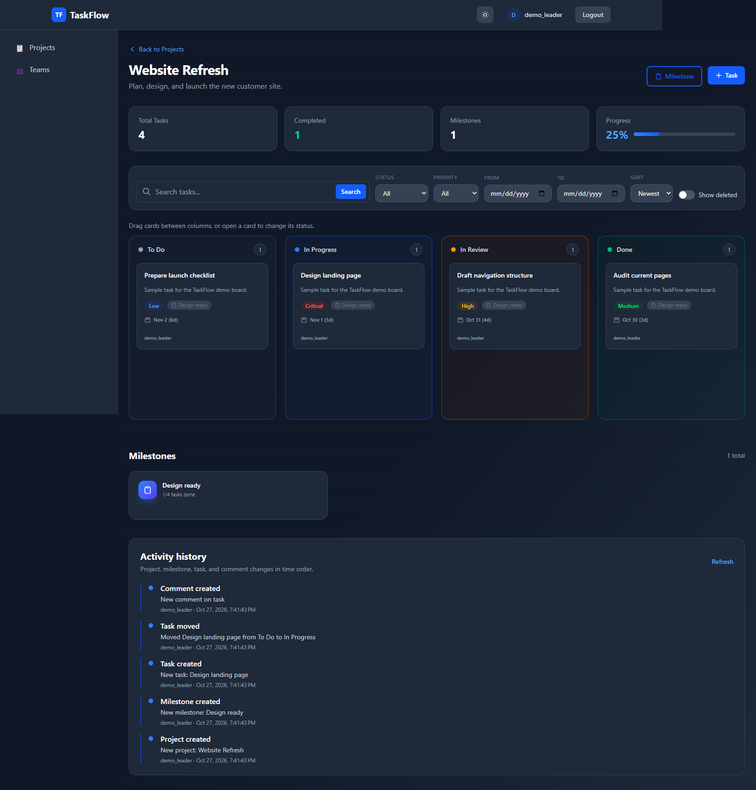
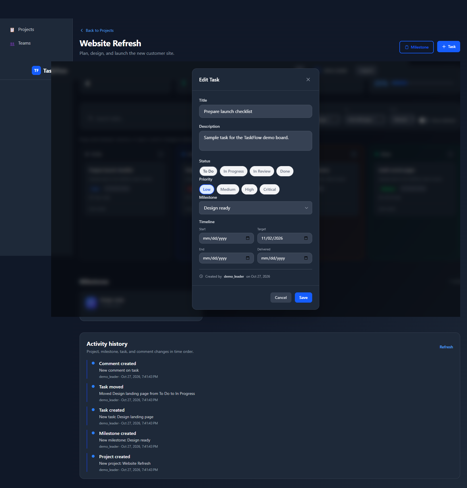
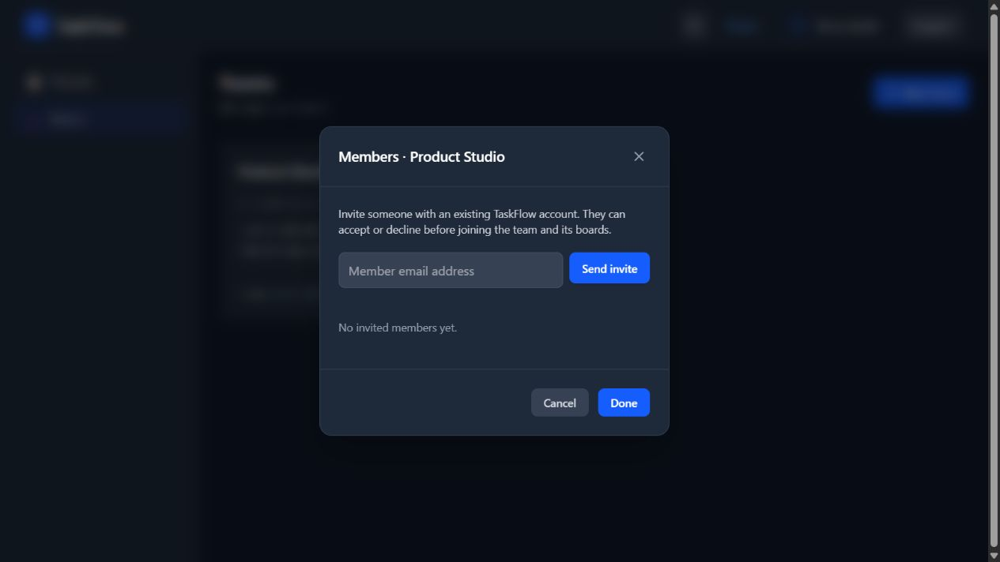
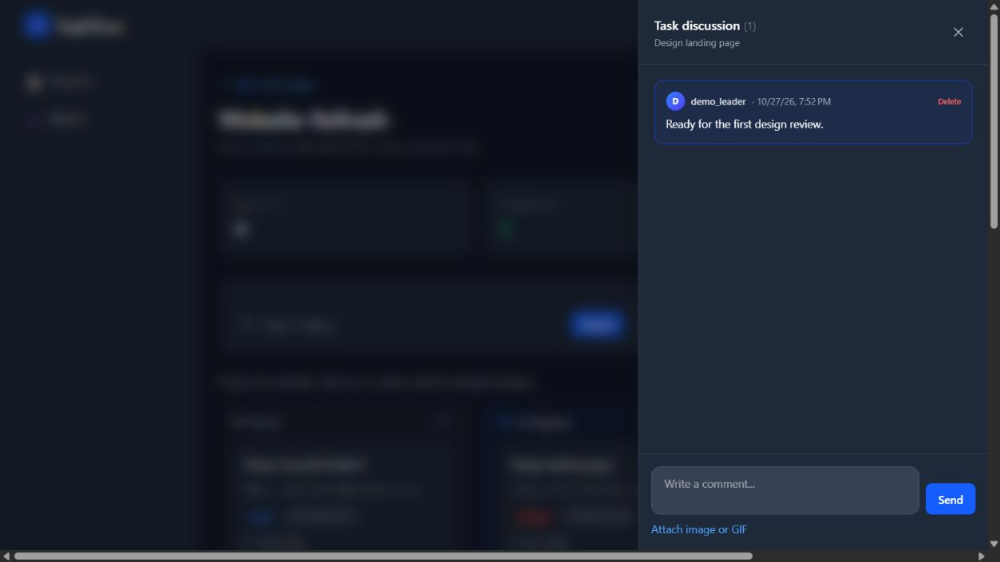

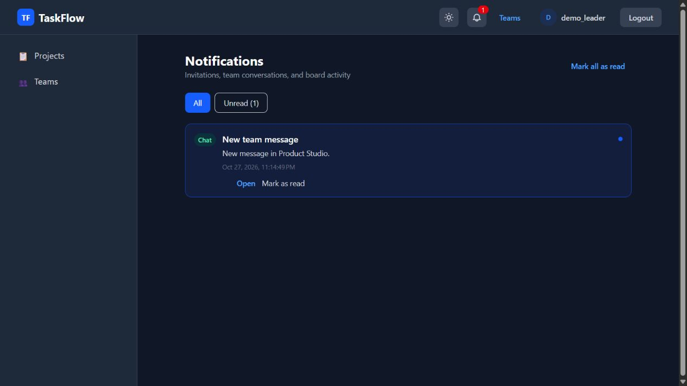
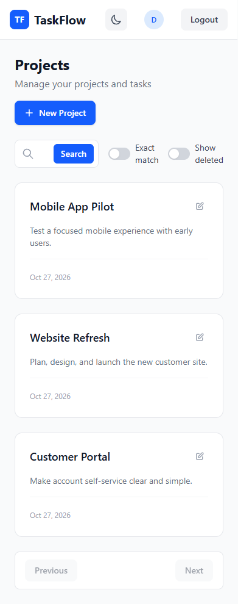

### Member in another group

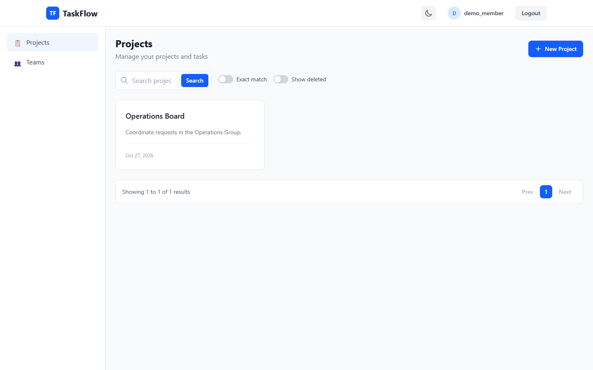
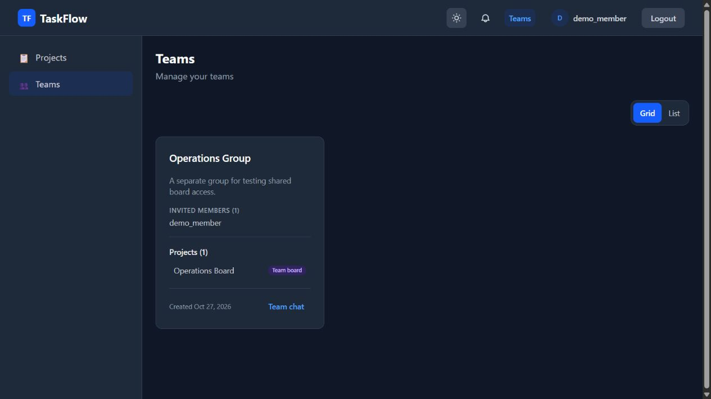
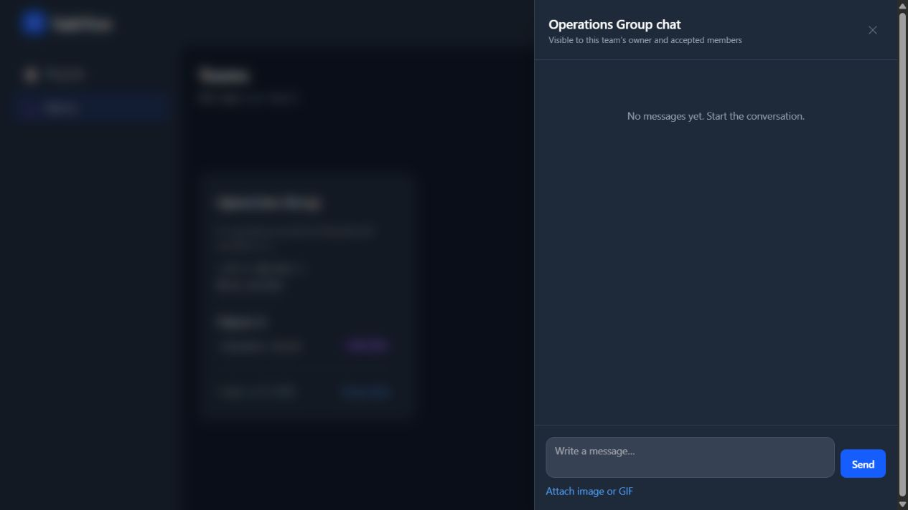
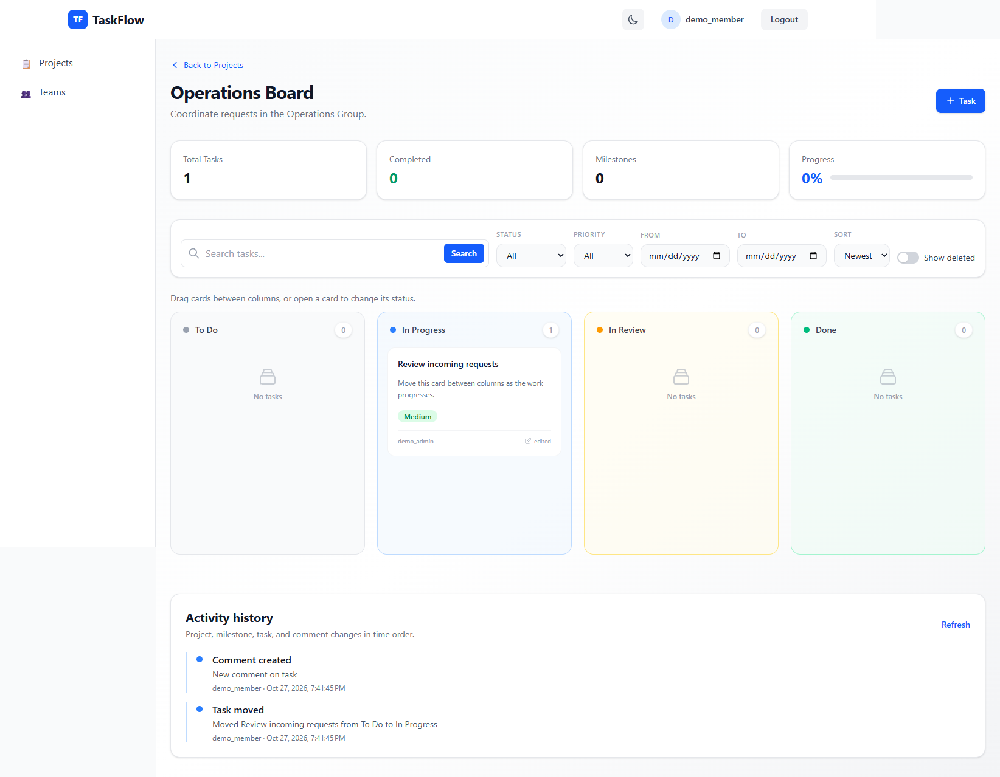
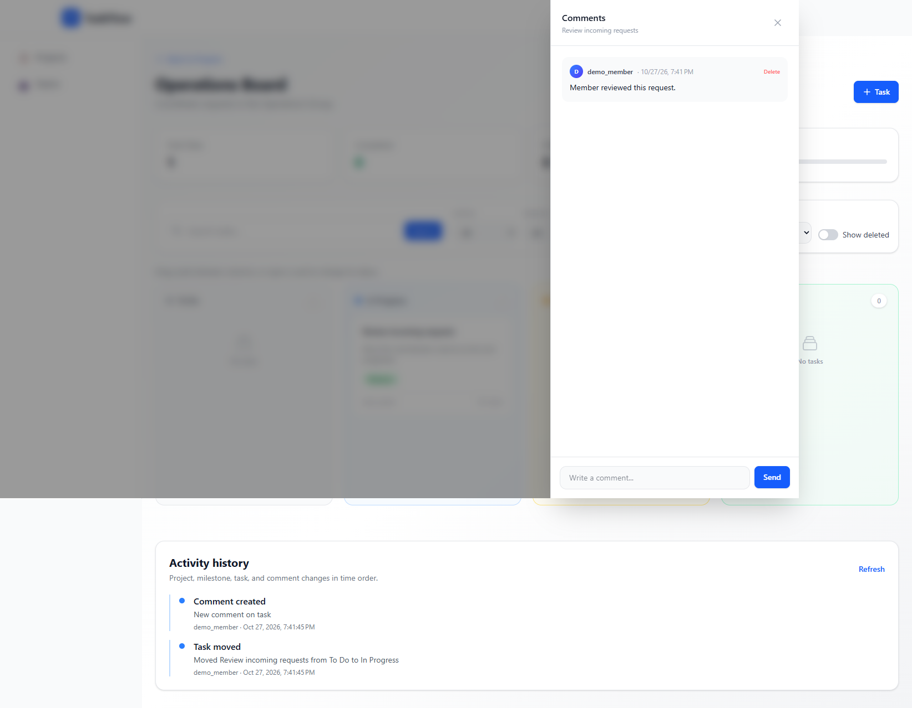

## Checks

```powershell
npm run build
npm test
```

See the [contract verification](https://github.com/HussainALAradi5/task-flow-proto-documenation/blob/main/contract-verification.md) for API route and role details.
